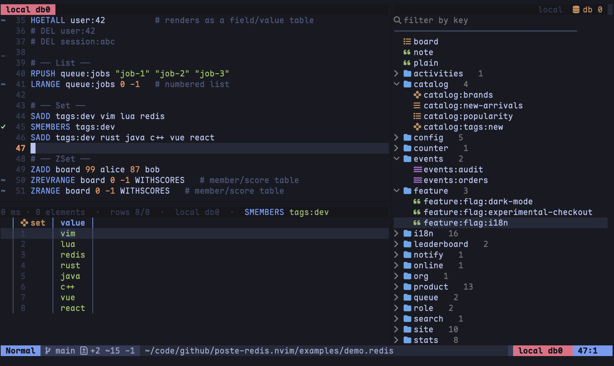

# poste-redis.nvim

[](https://github.com/poste-nvim/poste-redis.nvim/actions/workflows/ci.yml)

**Redis for Neovim in the [Poste](https://github.com/poste-nvim/poste.nvim) plugin family —**
write Redis commands in a `.redis` buffer, hit `<CR>`, and read the results in a result
panel. A key browser, value viewer and executable history are included.



## Install

With lazy.nvim:

```lua
{
  "poste-nvim/poste-redis.nvim",
  dependencies = {
    "saghen/blink.cmp",        -- completion (optional but recommended)
    "poste-nvim/poste-ai.nvim", -- optional: :PosteRedisChat with real context
  },
  opts = {},
}
```

Requires Neovim **>= 0.10.0** (`vim.system`, `vim.treesitter.language`) — the
CI matrix verifies current stable and nightly.

The plugin shells out to the `poste` binary: a usable one (readable **and**
executable, and on Windows also matched as `<candidate>.exe`) is resolved from
`vim.g.poste_binary`, `$POSTE_BINARY`, the install
path, a local dev build or `PATH`, and downloaded from poste.nvim releases
when none of those exists — as a background job that never blocks startup;
a notification announces when it lands, and until then commands that need the
binary report it missing (retry after the notification). Point
`vim.g.poste_binary` at your own build to skip the download.
`:checkhealth poste-redis` and `:PosteRedisInfo`
print which of those candidates won, since the install path outranks `PATH` and
a stray download would otherwise mask your own build silently. The download is
bounded (10s to connect, 180s for the archive), so a network that can't reach
GitHub fails with one notification per session instead of freezing anything.

Connections live in the project `connections.toml`:

```toml
[my-redis]
dialect = "redis"
url = "redis://:{{REDIS_PASS}}@127.0.0.1:6379/0"
```

`{{var}}` refs resolve from the OS env, `.env` and `env.json` (OS env wins).

## Usage

```redis
USE my-redis
SELECT 3
SET session:abc "token" EX 3600
GET session:abc
```

- `<CR>` executes the command under the cursor (or a visual selection);
  `:PosteRedisRunFile` runs the whole file. `USE` splits a file into
  per-connection batches that run sequentially; the `SELECT` above a
  selection is re-applied so single runs land on the right db.
- Results render in a bottom panel: scalars as text, collections
  (list/set/hash/zset) as a sortable grid with a frozen header, cell
  navigation, search, paging and yank. `i`/`o`/`dd` edit cells/rows back to
  Redis (with stale-cell guards, and a rename onto a field/member the key
  already has is refused instead of overwriting it); a cell the transport
  capped at `--max-bytes` refuses writes too — the panel holds a prefix, and
  storing it as the whole value would silently cut the tail; `r` re-runs the
  tab's command; `gd` jumps to the tab's key in the browser; `E` exports the
  whole grid to a file (CSV / TSV / JSON).
- `<Esc>` cancels an in-flight execution. Dangerous commands (`FLUSHALL`,
  `FLUSHDB`, `SHUTDOWN`, `CONFIG`, `SLAVEOF`, `REPLICAOF`) are flagged in the
  panel and, on `<CR>` or a file run, ask for an explicit yes before anything
  is dispatched (`confirm_commands = false` to opt out).

## Key browser

`:PosteRedisBrowser` opens a side split:

- Lazy `SCAN` loading — db expand costs one page, groups load on demand;
  flat / flatten / nested (`:`-segment folders) layouts via
  `:PosteRedisBrowserView`.
- `<leader>/` filters keys by substring; `<Space>` switches db; `o` switches
  connection; `d`/`D` delete keys/prefixes (multi-select with `<Tab>`),
  `t` TTL (on a selection: one prompt for every selected key), `R` rename,
  `i` info, `y` yank.
- `<CR>` on a key opens a paginated value viewer (HSCAN/SSCAN/ZSCAN/LRANGE
  pages); truncated strings load fully with `F`.

## History & docs

- `<leader>rh` opens the history sidebar beside the panel: j/k previews the
  snapshot live, `<CR>` restores it, `y` yanks an executable form.
- `K` on a Redis command (e.g. `HSET`, `RPUSH`) opens a markdown doc — syntax
  plus examples; pressing `K` again focuses the popup. Run `:PosteRedisInfo`
  to inspect the active connection.
- `<C-Space>` completes commands, keys and subcommands (blink.cmp source;
  works out of the box when blink is installed).
- With [poste-ai.nvim](https://github.com/poste-nvim/poste-ai.nvim)
  installed: `:PosteRedisChat` opens the AI chat with the active connection,
  key browser position, and value viewer content as real context.

`requirements.md` and `EXECUTION-PLAN.md` are the historical M1/M2 specs
(both milestones shipped); developer docs live in `docs/dev/`. Full
documentation lives in `doc/poste-redis.txt` (`:h poste-redis`).

## License

MIT
